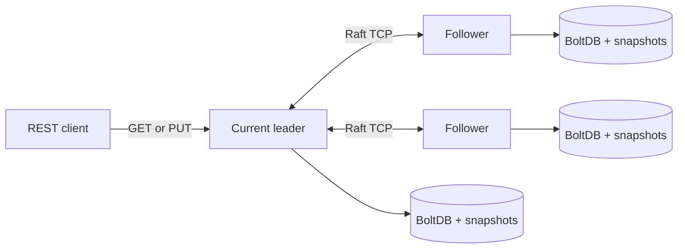

# Raft key-value store

A replicated UTF-8 key-value store in Go. Any voter can become leader. A successful PUT means a voting majority persisted its log entry and the leader applied it. GET also goes through the replicated log so a disconnected former leader cannot return a stale successful read. This simple read path costs a quorum round trip and grows the log.



## Run the three-node demo

From this directory, run `docker compose up --build -d`. The REST ports are 8001, 8002 and 8003 on localhost. In PowerShell, discover the current leader and write a value.

```powershell
function Find-Leader {
    foreach ($port in 8001..8003) {
        $url = "http://127.0.0.1:$port"
        try {
            if ((Invoke-RestMethod "$url/status" -TimeoutSec 2).role -eq "Leader") { return $url }
        } catch { continue }
    }
    throw "Election in progress. Retry in a moment."
}
$leader = Find-Leader
Invoke-RestMethod "$leader/kv/user42" -Method Put -Body 'Tobi' -ContentType 'text/plain'
Invoke-RestMethod "$leader/kv/user42"
```

For manual failover, get the leader's service ID with `(Invoke-RestMethod "$leader/status").leader`. Run `docker compose kill <service-id>`, then repeat leader discovery and GET after the election. Bring the killed service back with `docker compose start <service-id>`. Use `docker compose down` to stop the demo and retain its named volumes.

| Endpoint | Behaviour |
|---|---|
| PUT /kv/{key} | Raw UTF-8 body up to 64 KiB. Returns 204 after commit. Keys can be up to 256 bytes. |
| GET /kv/{key} | Returns a JSON object with a value field, or 404 for a missing key. |
| GET /status | Local role, known leader ID, and applied index. Followers return 503 on data operations and include the leader hint when known. |
| POST /snapshot | Requests a local snapshot. Returns 204 on success or when already current. |
| GET /debug/digest | SHA-256 of the local state encoded as sorted-key JSON. Intended for convergence checks. |

A client timeout or leadership loss can leave a write's outcome unknown. Retrying an identical PUT is suitable for the single-writer demo. Concurrent writers to the same key need application-level ordering if retries must never overwrite later values.

## Failure and performance test

The test launches three actual server processes on loopback with separate temporary data directories and ports. It writes 500 unique keys, starts a continuous writer, hard-kills the elected leader, and times the first acknowledged write started after the kill. It keeps the old leader down for another 80 writes, compacts the replacement leader's log, brings the old leader back, then hard-restarts all three. After recovery and again after restart it reads every acknowledged value and compares every replica's state digest with the client's expected digest.

Run with Python 3.10+ and Go 1.25+ from this directory.

```powershell
go build -o raftkv.exe .
python chaos.py --binary ./raftkv.exe --report benchmark-local.json
```

On Linux or macOS use `go build -o raftkv .` and `python3 chaos.py --binary ./raftkv`.

| Three native trials | Median | Range |
|---|---:|---:|
| Acknowledged writes per second | 711.89 | 279.96–853.27 |
| Kill to first recovered write | 1.944 s | 1.937–2.687 s |

All three trials recovered 582 acknowledged keys apiece, including the post-failover writes. Measurements used Windows 11, Intel Core Ultra 9 185H, Go 1.27.4, 8 concurrent HTTP clients, 64-byte values, one TCP connection per request and one physical host. Election detection includes client polling. This short test measures the whole local HTTP write path. See [individual trials](benchmark.json).

## Browser interface

With the three demo nodes running, start the optional browser interface with Node.js 20+ using `node frontend/server.mjs`. Open [the local store](http://127.0.0.1:8780/) to read or write a value. The frontend discovers the elected leader on each request.

## Implementation

HashiCorp Raft supplies elections, log replication, membership bootstrap and snapshot transfer. The Go service implements the REST contract, committed state machine, snapshot encoding and restore, durable storage wiring, and diagnostic endpoints. The Python harness drives load, injects failures and checks recovery.

Each process accepts `-id`, `-http`, `-data` and a common ordered `-peers` list (for example `n1=127.0.0.1:7001,n2=127.0.0.1:7002,n3=127.0.0.1:7003`). Use separate directories and addresses per voter. Only the first listed voter bootstraps a fresh cluster. Configure 3–5 fixed voters at initial startup. Reuse their identities and volumes on restart. Snapshot checks run at randomized intervals starting at 20 seconds once 128 log entries accumulate. Compaction retains 32 trailing entries and two snapshots per node.

The API and Raft transport assume a trusted local network. The packaged Compose file publishes REST only on loopback. The recorded benchmark uses native processes.
